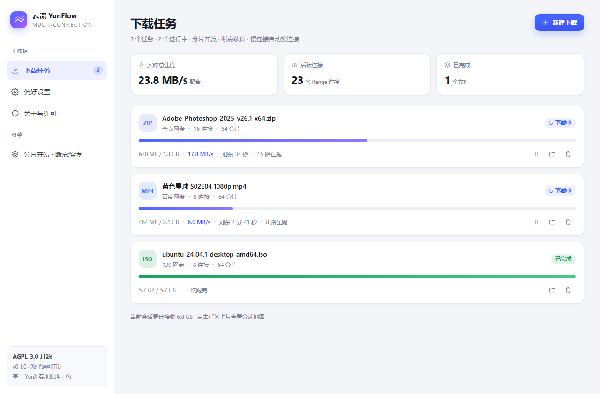
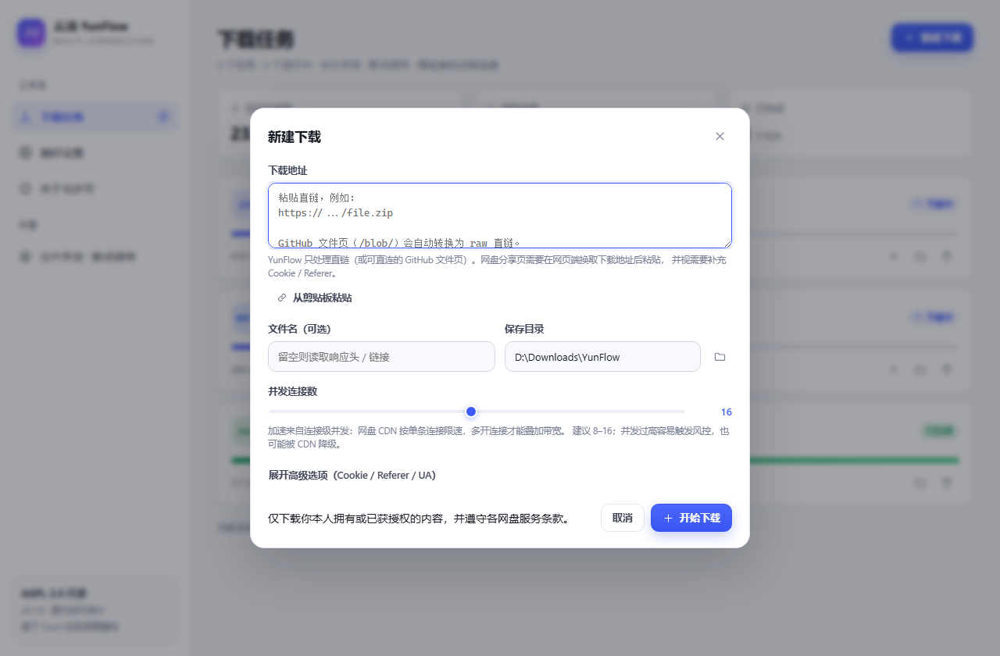
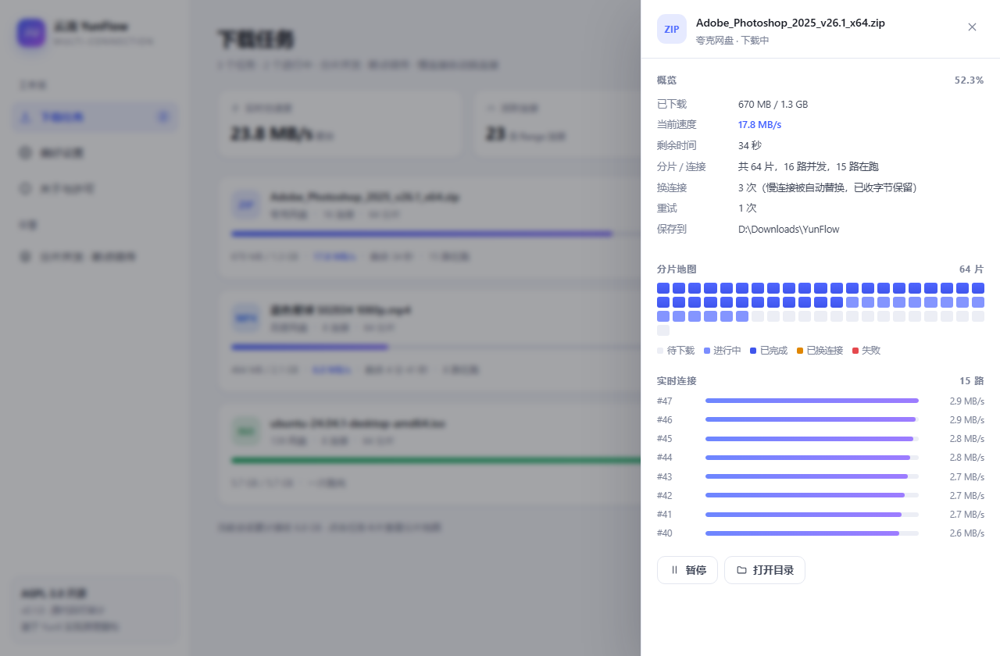

# 云流 · YunFlow

**把文件切成几十片，用几十条连接同时拉 —— 桌面端网盘下载加速器。**

[](./LICENSE)
[](#快速开始)
[](https://www.electronjs.org/)
[](https://www.typescriptlang.org/)

YunFlow 是一个以 **多连接 Range 并发** 为核心的桌面下载器。它不依赖任何网盘私有接口，
只做一件事并把这件事做扎实：把一个直链变成几十条并发连接，再把分片严丝合缝地拼回原文件。

> 本项目基于对开源项目 [YunX（云析）](https://github.com/CYQawa/YunX) 源码的研究重新实现，
> 遵循 **AGPL-3.0-or-later**。原项目 Copyright (C) 2026 CYQawa，同样以 AGPL-3.0 授权。
> 详见 [许可证与致谢](#许可证与致谢)。



---

## 加速原理（一句话版）

网盘 CDN 的限速是**按连接**施加的。一条连接被限制在 100 KB/s，十六条连接就能叠加到 1.6 MB/s。
所以真正的工程量不在"多开几个请求"，而在：

1. **探测**：`Range: bytes=0-0` 校验服务器是否真的支持 206，顺手识别防盗链 HTML 页；
2. **规划**：分片数 = `max(按大小分档, 线程数 × 8)`，夹在 `total/256KB` 与 512 之间；
   前 70% 定长（主池），后 30% 交给弹性分配器；
3. **调度**：worker 先按序号领主池，再按字节顺序领弹性块；全局信号量限制在飞请求总数；
4. **治理**：看门狗每 5 秒采样每路速度，低于 `max(12KB/s, 均速/2)` 就**主动断开并换连接续传**，已收字节全部保留；
5. **校验合并**：每片边写边算 SHA-256，合并时逐片重算比对，写一片删一片。

完整源码级分析（含常量表、失败模式、与 YunX 的逐项对照）见 **[docs/YUNX-ANALYSIS.md](docs/YUNX-ANALYSIS.md)**。

---

## 截图

| 新建下载 | 任务详情 · 分片地图 |
| --- | --- |
|  |  |

分片地图把每个分片的状态画出来：蓝=已完成、浅紫=正在跑、灰=待下载、橙=被换过连接、红=失败。
右下角的实时连接列表就是"每个 worker 此刻在干什么"。

---

## 功能

- **多连接分片下载** —— Range 并发 + 断点续传，单任务上限 **桌面 512 路 / 移动 32 路**（与 YunX 一致），另有平台 CDN 阈值兜底
- **慢连接自动换连接** —— 卡在慢节点上的连接会被主动掐断，从已收字节续传，而不是从头再来
- **分片级完整性校验** —— SHA-256 逐片比对，拒绝"长度对但内容是洞"的损坏文件
- **暂停 / 继续 / 重试 / 删除** —— 暂停保留分片，重启应用后仍可续传
- **失败回退** —— 服务器忽略 Range 时自动切单流，绝不把整文件写进一个分片
- **分片地图可视化** —— 每个分片的起点、已收字节、瞬时速度、换连接次数都能看到
- **平台预设** —— 夸克 / UC / 迅雷 / 百度 / 123 / 139 / GitHub / 通用直链，按平台自动选择并发上限与 Referer
- **GitHub 直链转换** —— `/blob/` 文件页自动转成 `raw.githubusercontent.com`
- **全局限速与在飞配额** —— 按任务限速，进程级信号量兜底，避免内存与文件句柄失控
- **直链过期自动重取** —— 网盘直链失效时自动重新取链并从断点继续，重试也不再复用死链
- **文件夹批量下载** —— 浏览文件时可一键下载整个目录（可选含子文件夹，上限 200 个文件）
- **系统托盘与完成通知** —— 关闭窗口后台继续下载，完成时弹系统通知，托盘菜单随时回主界面
- **剪贴板自动识别** —— 复制直链后切回窗口，提示一键加入下载（可在设置中关闭）
- **直链过期自动重取** —— 网盘直链失效时自动重新取链并从断点继续，重试也不再复用死链
- **文件夹批量下载** —— 浏览文件时可一键下载整个目录（可选含子文件夹，上限 200 个文件）
- **系统托盘与完成通知** —— 关闭窗口后台继续下载，完成时弹系统通知，托盘菜单随时回主界面
- **剪贴板自动识别** —— 复制直链后切回窗口，提示一键加入下载（可在设置中关闭）
- **深色 / 浅色主题** —— 跟随系统或手动切换

---

## 支持范围与限制（请先读这一段）

YunFlow 只处理**直链**（以及可直连的 GitHub 文件页）。"加速"发生在传输层，
不包含"把分享页变成直链"这一步。

| 平台 | 加速 | 并发上限 | 直链来源 |
| --- | :---: | ---: | --- |
| 夸克网盘 | ✅ | 32 | 网页端复制下载地址 + 可选 Cookie |
| UC 网盘 | ✅ | 32 | 同上 |
| 迅雷网盘 | ✅ | **8** | 同上（该 CDN 超过约 8 路会降级成 200 整文件） |
| 百度网盘 | ✅ | 16 | 同上，风控严格，建议非主力账号 |
| 123 云盘 | ✅ | 32 | 同上 |
| 139 网盘 | ✅ | 16 | 同上 |
| GitHub | ✅ | 32 | 直接粘贴，文件页会自动转 raw |
| 任意 HTTP(S) 直链 | ✅ | 32 | 直接粘贴 |

**为什么不做分享页解析？** 六家网盘换取直链的接口是私有的、带签名、随版本变更，
而且需要账号 Cookie。内置这类解析器意味着持续维护逆向接口，一旦失效就会以"下载了一个 12 KB 的 HTML"收场。
YunFlow 选择把这件事留在传输层之外：你从浏览器拿到直链，剩下的交给引擎。
如果你需要接入自己的解析服务，`src/main/resolvers/` 提供了清晰的扩展点（见 [docs/ARCHITECTURE.md](docs/ARCHITECTURE.md)）。

粘贴 `https://pan.quark.cn/s/...` 这类分享页链接时，程序会**明确提示**你需要先换取直链，
不会假装成功、也不会把 HTML 当文件存下来。

---

## 快速开始

### 直接运行（免安装，推荐）

`release/YunFlow-win32-x64/` 已经是一个**自带运行时**的完整应用，不需要 Node.js、不需要 `npm install`、
启动时不联网：

```
release/YunFlow-win32-x64/
├─ YunFlow 云流.lnk      ← 双击这个
├─ YunFlow.exe           ← Electron 主程序（需要 --no-sandbox 参数，见下）
├─ YunFlow.cmd           ← 快捷方式失效时的兜底启动器
├─ resources/app/        ← 应用代码（编译后的主进程 + 前端）
├─ *.dll / *.pak / locales/  ← Chromium + Node 运行时
└─ data/                 ← 首次运行自动创建：配置、任务、分片、日志
```

- **启动方式**：双击 `YunFlow 云流.lnk`。
- **为什么是快捷方式**：Chromium 的沙箱初始化在部分 Windows 环境中会失败，进程会在创建窗口前直接崩溃
  （`0x80000003`）。`--no-sandbox` 必须出现在**进程启动参数**里，双击裸 exe 无法传递，所以用快捷方式携带。
  该参数只影响 Chromium 的 OS 沙箱；界面仍然启用 `contextIsolation`、禁用 `nodeIntegration`，
  并由 CSP 限制为只加载本地资源。
- **迁移**：整个文件夹拷走即可。若快捷方式因路径变化失效，双击 `YunFlow.cmd`。

### 从源码运行（开发）

环境要求：Node.js ≥ 20，npm ≥ 10。

```bash
git clone <本仓库地址>
cd yunflow-desktop

npm install
npm run dev          # 开发模式：Vite + Electron 热更新
```

Windows 用户也可以双击 **`start.cmd`**：它会安装依赖、编译并启动（仅开发用）。

### 打包

```bash
npm run package      # 生成免安装便携版 → release/YunFlow-win32-x64/
npm run dist         # 可选：electron-builder 安装包（需要联网拉取 NSIS 组件）
```

`npm run package` 只复制 `node_modules/electron/dist` 与 `dist/`，**全程离线**，产物可复现。
打包范围（约 318 MB）：

| 内容 | 来源 | 说明 |
| --- | --- | --- |
| Chromium + Node 运行时 | `node_modules/electron/dist` | `YunFlow.exe` 及全部 dll/pak/locales |
| 应用代码 | `dist/main`、`dist/preload`、`dist/renderer` | 主进程、预加载、前端静态资源 |
| 许可与文档 | `LICENSE`、`NOTICE`、`README.md` | AGPL-3.0 要求随二进制分发 |
| 启动器 | 打包脚本生成 | 快捷方式 + `YunFlow.cmd` |

运行期**零网络依赖**：不检查更新、不下载运行时、不访问任何服务器（除了你添加的下载任务本身）。

### 先本地验证（建议）

不想拿真实网盘冒风险，可以先用内置的限速演示服务器验证引擎：

```bash
# 终端 1：启动一个每连接限速 1.5 MB/s 的本地文件服务
npm run demo
```

它会打印形如 `http://127.0.0.1:5410/demo.bin` 的地址、文件大小与 SHA-256。

```bash
# 终端 2：启动应用（Windows 也可以直接双击 start.cmd）
npm run dev
```

把上面的地址粘进「新建下载」：

| 并发数 | 预期表现 |
| ---: | --- |
| 1 | 稳定在 1.5 MB/s 左右 |
| 8 | 约 12 MB/s |
| 16 | 约 20 MB/s 以上 |

下载完成后核对 SHA-256 与 demo 服务打印的值一致，即说明分片拼接与校验链路无误。
这个过程不产生任何外部流量，也不涉及账号。

---

## 使用流程

**省事的做法**：先在「网盘账号」里登录一次（官方网页，扫码/短信都行），之后该平台的任务会自动带上 Cookie，
不用再碰开发者工具。

需要手动取直链时：

1. 在浏览器里打开网盘网页版，进入目标文件，点击下载；
2. 打开开发者工具 → Network，找到该文件的请求（通常是 `Range` 或返回 `206` 的那条），
   复制完整的请求 URL；
3. 回到 YunFlow → 新建下载 → 粘贴 URL；
4. 没登录过该平台时，展开「高级选项」粘贴同一条请求的 `Cookie` 与 `Referer`；
5. 选择保存目录与并发数，开始。

参数建议：

| 场景 | 并发 | 说明 |
| --- | ---: | --- |
| 默认 | 8–16 | 先跑通，再往上加 |
| 夸克 / UC / 123 | 16–64 | Range 支持好，收益明显；上限 512 |
| 迅雷 | 8 | 超过 CDN 阈值会被降级成整文件响应，反而更慢 |
| 百度 | 8–16 | 并发越高越容易触发风控 |
| 小文件（< 5 MB） | 1–4 | 分片开销大于收益，程序也会自动减少分片 |

---

## 并发上限与线程校验

上限分三层，任何一层都不会被绕过：

| 层级 | 桌面端 | 移动端 | 说明 |
| --- | ---: | ---: | --- |
| 运行平台硬上限 | **512** | **32** | 与 YunX 的线程上限一致；512 路 ≈ 512 条 HTTP/1.1 连接 + 32 MB 读缓冲 |
| 平台 CDN 上限 | 512（迅雷 8） | 同左 | 只有迅雷需要压低：超过约 8 路并发 Range，其边缘节点会返回 200 整文件 |
| 用户请求 | 1–512 | 1–32 | 非法值回退、超限截断 |
| 全局在途配额 | 8–512 | 8–32 | 进程级信号量，多任务共享 |

默认值：全局默认 **8**；平台预设夸克/UC/123/GitHub/直链 **16**，迅雷/百度/139 **8**；
`maxInflightChunks` 默认 **512**（要跑满 512 路，这里不能低于线程数）。

校验规则（`src/shared/thread-policy.ts`，纯函数、有单测）：

| 输入 | 结果 |
| --- | --- |
| 非数字（`"abc"`、`null`） | 回退到默认值 8 |
| 负数 / 0 | 修正为 1 |
| 小数 | 向下取整 |
| 超过平台 CDN 上限（如迅雷 128） | 截断到 8，并在任务日志中说明原因 |
| 超过运行平台上限（如桌面 9999） | 截断到 512 |
| 恢复的历史任务（`tasks.json` 被手改） | 读取时同样过一遍校验 |

校验点分布在三处：新建任务（IPC 入口）、设置保存、启动时恢复任务。引擎内部还有一道
`MAX_THREADS = 512` 的兜底，所以即使绕过 UI 直接改文件，调度器也不会被推到 512 以上。

---

## 关于登录与鉴权

当前版本**实现了账号登录，但不实现账号密码表单**：登录在网盘自己的网页里完成，
YunFlow 只接收登录后产生的 Cookie。这样扫码、短信、验证码、风控全由官方页面处理，
软件永远不接触你的密码。

| 能力 | 状态 | 说明 |
| --- | --- | --- |
| 内嵌官方登录页 | 已实现 | 「网盘账号」→ 登录，打开该网盘官网登录页 |
| Cookie 捕获 | 已实现 | 关闭登录窗口后按域名抓取（含 HttpOnly） |
| 加密存储 | 已实现 | Electron `safeStorage`（Windows 上为 DPAPI）；无密钥环时降级明文并显式告警 |
| 任务自动复用 | 已实现 | 该平台的新任务自动带上 Cookie，无需每次粘贴；手动填写的 Cookie 优先 |
| 退出登录 | 已实现 | 同时清除本地 Cookie 与该站点的 storage 分区 |
| 账号昵称 / 容量 | 已实现 | 六家各一个接口，字段见 docs/YUNX-ACCOUNTS.md |
| 文件列表 / 点开即下载 | 已实现 | 支持进子目录、面包屑、直接加入下载队列 |
| 分享链接转存 | 未实现 | 需要各平台 share/save 接口；目前请在官方客户端保存到网盘 |

逐平台现状：

| 平台 | 服务端是否要求登录 | 登录方式 | 登录后 |
| --- | --- | --- | --- |
| 夸克 / UC / 123 / 139 | 是 | 官方网页（扫码/密码） | Cookie 自动用于该平台任务 |
| 迅雷网盘 | 是 | 官方网页登录 | 同上；未做密码/短信直连接口 |
| 百度网盘 | 是 | 官方网页（扫码/密码） | 同上；高并发仍可能触发风控 |
| 分享页 `/s/...` | 需要解析接口 | — | 仍不支持，会明确报错 |

存储与边界：

- Cookie 保存在 `data/accounts.json`，加密后落盘；只有本机可解密，不上传任何服务器。
- Cookie 过期后下载会返回 401/403 或 HTML 拒绝页，程序会明确报错，不会把 HTML 存成文件；
  在「网盘账号」里点「重新登录」即可刷新。
- 登录态不保存密码，也不调用任何需要账号密码的私有接口。

**接口来源与验证状态**：六家的容量、文件列表、取链接口移植自 YunX 的抓包实现
（`src/main/drives/adapters/`，含 123 的 crc32 签名与 139 的 mcloud-sign），
字段与请求头逐一对照。由于我这里没有各平台账号，**未做真实账号回归**：
若某个平台读取失败，界面会直接显示接口返回的错误文本，把那段文字发我即可按真实返回修正。
已知易变点：123/迅雷的 token 在 localStorage 里的键名、139 的渠道头、百度 locatedownload 的常量。

---

## 架构

```
src/
├─ main/                     Electron 主进程
│  ├─ index.ts               窗口与生命周期
│  ├─ ipc.ts                 IPC 契约（任务、设置、目录、剪贴板、账号）
│  ├─ accounts/              登录窗口 + Cookie 加密仓库（safeStorage）
│  ├─ platforms.ts           平台预设（并发上限 / Referer / 强调色）
│  ├─ resolvers/             直链解析层（direct / github / 扩展点）
│  └─ engine/
│     ├─ http.ts             请求、重定向、Range 探测、Content-Range 校验
│     ├─ chunk-plan.ts       分片规划与续传签名
│     ├─ elastic-allocator.ts 弹性区分配（速度自适应 + 尾部收缩）
│     ├─ chunk-downloader.ts 单分片下载（续传 / 截断 / 重试 / 摘要）
│     ├─ speed-watchdog.ts   慢连接判定（纯函数，可单测）
│     ├─ task.ts             任务编排（worker 池、看门狗、合并）
│     ├─ manager.ts          队列、持久化、广播
│     └─ util.ts             信号量、令牌桶、取消语义
├─ preload/index.ts          contextBridge 白名单
├─ renderer/                 React 18 + Vite
└─ shared/                   主进程与渲染层共享的类型与平台表
```

关键取舍：

- **并发单位是 HTTP 连接**，不是线程。Node 的磁盘 IO 由 libuv 线程池异步完成，
  所以不需要像 Android 那样自建 `ThreadPoolExecutor`；限流靠 `Semaphore` 控连接数。
- **合并是同卷流式写入**：分片放在 `<下载目录>/.yunflow/<taskId>/`，合并时写一片删一片，
  峰值占用 ≈ 文件大小 + 一个分片。
- **续传靠计划签名**：`plan.json` 记录 `chunks/total/main/size`，线程数或文件大小变了就清空重下，
  避免旧分片区间错位拼出损坏文件。

---

## 测试

```bash
npm test
```

8 个用例覆盖：分片规划边界、`Content-Range` 解析、看门狗判定、端到端字节一致性、
暂停/续传、Range 被忽略时的单流回退、以及慢连接抢占。测试用本地 HTTP 服务模拟限速与坏节点，
不需要外网。

```
# pass 8
# fail 0
```

---

## 技术栈

| 层 | 选择 | 理由 |
| --- | --- | --- |
| 桌面壳 | Electron 37 | 三端一致、原生文件对话框与托盘、调试成本低 |
| 界面 | React 18 + 手写 CSS | 不引入 UI 框架，分片地图与实时速度需要细粒度控制 |
| 语言 | TypeScript 5.7（strict） | 引擎与 IPC 共享类型，减少契约漂移 |
| 构建 | Vite 6 + tsc | 渲染层热更新，主进程直接编译为 CommonJS |
| 网络 | Node `http`/`https` + keep-alive Agent | 对 Range、超时、Abort 的控制比 fetch 更直接 |
| 测试 | `node:test` + tsx | 零额外框架，直接跑真实 HTTP 传输 |

---

## 路线图

- [ ] HLS（m3u8）分片下载与合流
- [ ] 多源分片（同一文件多条直链轮转，对应 YunX 的实验性 C2）
- [ ] 代理与镜像前缀
- [ ] 任务分组与批量导入
- [ ] 托盘进度与系统通知

---

## 常见问题

**双击后没有窗口，进程立刻退出（`0x80000003` / `0xC0000005`）**

这是 Chromium 在创建窗口之前就崩了，和界面代码无关。目前已确认两个独立诱因，免安装版都已规避：

1. **用户数据目录创建失败**。默认 profile 位于 `%APPDATA%\<app>`，在漫游配置、重定向目录或被安全软件
   接管的机器上可能建不出来，Chromium 随即在启动阶段空指针崩溃。免安装版把 profile 放到程序目录下的
   `data\`（见 `src/main/index.ts` 的 `configurePortableProfile`），彻底绕开。
2. **Chromium 的 OS 沙箱初始化失败**。此时必须在**命令行**上传入 `--no-sandbox`，应用内
   `app.commandLine.appendSwitch()` 已经来不及（浏览器进程在此之前就退出了）。所以发布的包用快捷方式
   携带该参数，裸 exe 不建议直接双击。

排查顺序：先看 `data\startup.log`（有记录说明 JS 已经跑起来，问题在渲染层），
没有记录说明进程在 JS 之前就死了，属于上面两类。

**点了下载没反应，或任务立刻变成「失败」**

最常见的原因是**下载目录不可用**。典型是把目录设成盘符根目录（`F://`、`D://`）：Windows 上
`mkdir('F://')` 会返回 `EPERM`（根目录已存在，不能再创建），旧版本会在建任务之前就失败 ——
既不产生任务记录，也不写任何日志，只弹一个一闪而过的提示。

现已修复：

- 已存在的目录直接视为成功，只有真正缺失时才创建
- 保存设置与建任务时都会**真实写一个探测文件**，确认目录能接收下载；不可用当场提示并保留原值
- 分片临时目录默认放在下载目录旁的 `.yunflow\<任务ID>`；若该磁盘拒绝创建目录
  （ACL 只允许建文件、不允许建文件夹时会出现），自动改放到 `data\parts\<任务ID>` 并在任务日志说明，
  完成后仍然合并到原下载目录
- 每次建任务 / 建任务失败都会写入 `data\tasks.log`（目录、线程数、CDN 主机、错误原文）；每次下载失败
  也会记录首条真实错误，重试覆盖不了它

**点了「打开所在文件夹」没有任何反应**

旧版本由界面自己拼路径（`目录 + '/' + 文件名`），当目录是盘符根（如 `F://`）时会拼出
`F:///文件名`，资源管理器 API 收到这种路径会**静默失败**。现已改为按任务 ID 在主进程解析，
用 `path.join` 拼接，并先确认文件存在；文件被移动/删除时回退打开所在目录，
打不开时给出明确错误而不是无响应。

**如果提示「下载目录不可用」或「…不可写，本次改存到 …」**

说明该目录不允许本程序写入。常见于：

- 下载目录设成了**可移动磁盘的根目录**（U 盘 / 移动硬盘的 `F://`）
- 目录 ACL 只允许列目录、不允许创建文件
- 宿主环境对进程做了写限制（同一台机器上其他程序能写、本程序不能写）

程序会**自动改存到 `data\downloads\`**（跟随程序目录），并在任务日志与提示里写明实际位置，
不会再让整次下载失败。想让它回到你要的盘，可以：

1. 在该盘里手动新建一个普通文件夹（如 `F://下载`），在设置里选它；
2. 或右键应用 → **以管理员身份运行** 后再试（发布包里的「YunFlow 云流」快捷方式已默认带
   这个标记：每次启动会弹 UAC 确认框；启动日志 `data\startup.log` 会有一行
   `dir probe F://: writable / NOT writable`，用它即可确认提权是否解决了写入问题；不想要提权
   就右键快捷方式 → 属性 → 兼容性，取消该勾选）；
3. 用记事本往 `F://` 存一个 txt 做对照：若记事本也存不进去，就是系统/安全策略对该磁盘的限制，
   与本程序无关。

**某家网盘登录成功但读不到容量 / 打不开文件列表**

账号卡片会直接显示接口返回的错误原文，先按这句提示判断：

| 提示 | 含义与处理 |
| --- | --- |
| `unauthenticated：帐号认证失败，请重新登录` | 令牌过期或无效。点卡片上的「重试」会先尝试用 refresh_token 换新令牌；仍失败就重新登录 |
| `captcha_invalid：验证码无效` | 迅雷的调用需要 300 秒有效期的验证码，程序会用一个隐藏页面从登录会话里现取。若持续报这句，说明登录会话已失效，重新登录即可 |
| `未找到迅雷登录令牌，请重新登录` | 登录窗口没读到 localStorage。重新登录，并**等网盘文件页面真的出现、能看到文件后再关窗口** |
| `迅雷未返回空间字段（响应字段：…）` | 接口改了返回结构。把括号里的字段名和 `data\drives.log` 发到 issue |
| `迅雷文件列表返回了未知结构（字段：…）` | 同上，列表接口变了。真·空目录不会报这句 |
| `登录态已失效（接口返回了网页）` | 服务端把请求当成未登录，返回了 HTML 登录页。重新登录 |

所有网盘接口的失败都会追加到 `data\drives.log`（时间 + 平台 + 错误原文，不含令牌）。
迅雷与 123 的登录令牌存在登录页的 localStorage 里，程序在关窗时会做最后一次读取，
所以**不要**在登录还没跳回网盘页面时就关掉窗口。

**`npm run dev` 提示端口被占用**：Vite 固定使用 5273，改 `vite.config.ts` 里的 `server.port` 即可。

**演示服务器端口冲突**：用 `PORT=5411 npm run demo` 换一个端口（cmd 下为 `set PORT=5411 && npm run demo`）。

**为什么速度没有明显提升**：先确认链接真的支持 Range。任务卡片上若显示「单流回退」，
说明服务器对 Range 请求返回了 200，多连接无从谈起，这类资源只能单连接下载。

---

## 许可证与致谢

本项目以 **GNU Affero General Public License v3.0 or later** 发布，全文见 [LICENSE](./LICENSE)。

- 原始设计与调度策略来自 **[YunX（云析）](https://github.com/CYQawa/YunX)**，
  Copyright (C) 2026 **CYQawa**，AGPL-3.0。
- 本项目是独立的 TypeScript 重写：未复制任何 Kotlin 源文件，保留了其分片规划阈值、
  看门狗判据与正确性规则。修改说明见 [docs/YUNX-ANALYSIS.md](docs/YUNX-ANALYSIS.md) 第 8 节。
- 每个实现该设计的源文件头部均保留原项目的版权与许可声明；完整归属声明见 [NOTICE](./NOTICE)。
- 依据 AGPL-3.0 第 13 条，若你通过网络使用本软件，有权获得对应的完整源代码。

---

## 合规声明

- 本工具只改变传输方式，**不改变内容的版权归属**。请仅下载你本人拥有、或已获得明确授权的内容。
- 使用第三方直链可能违反网盘的服务条款并触发风控，请自行评估风险，建议不要使用主力账号。
- 本项目不内置任何网盘私有解析接口，不提供账号、会员或破解类服务。
- 因使用本软件产生的账号限制、数据丢失或法律风险，由使用者自行承担。
